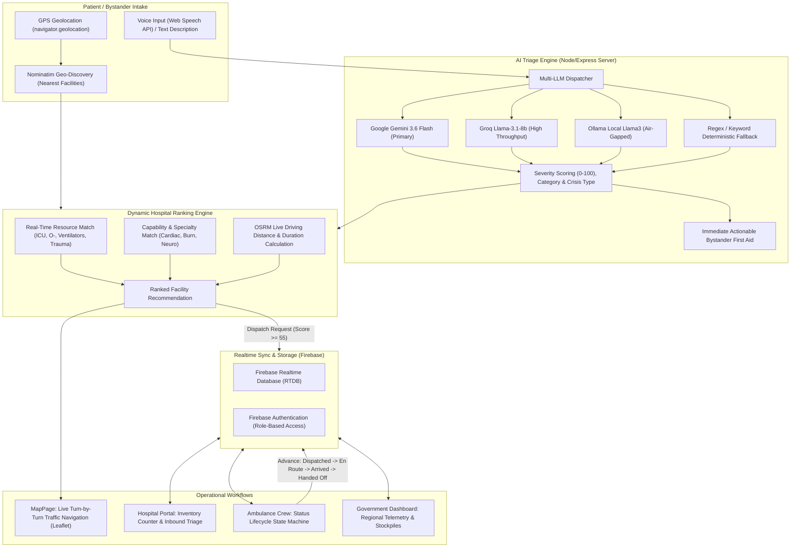

<h1 align="center">WardWatch</h1>

<p align="center">
  
</p>

<h2 align="center"><strong>Next-Gen Emergency Medical Triage & Dynamic Hospital Resource Allocation Protocol.</strong><br> Every second matters. Zero turnaround delays. Real-time critical care.</h2>

<details>
<summary style="font-size: 24px; font-weight: bold; cursor: pointer;"><h1>Table of Contents</h1></summary>

- [Architecture Diagram](#architecture-diagram)
- [Deployment](#deployment)
- [The Problem](#the-problem)
- [Our Solution](#our-solution)
- [Core Multi-Portal Ecosystem](#core-multi-portal-ecosystem)
  - [1. Patient Emergency Intake & AI Triage](#1-patient-emergency-intake--ai-triage)
  - [2. Live Turn-by-Turn Navigation & Traffic Routing](#2-live-turn-by-turn-navigation--traffic-routing)
  - [3. Hospital Capacity & Inventory Management](#3-hospital-capacity--inventory-management)
  - [4. Ambulance Dispatch & Active Lifecycle](#4-ambulance-dispatch--active-lifecycle)
  - [5. Government Central Command Telemetry](#5-government-central-command-telemetry)
- [The Dynamic Hospital Ranking Formula](#the-dynamic-hospital-ranking-formula)
- [Offline-First & Zero-Failure Resilience](#offline-first--zero-failure-resilience)
- [Tech Stack](#tech-stack)
- [Installation & Setup Guide](#installation--setup-guide)
  - [1. Prerequisites](#1-prerequisites)
  - [2. Frontend Setup](#2-frontend-setup)
  - [3. Backend Setup](#3-backend-setup)
  - [4. Environment Variables Configuration](#4-environment-variables-configuration)
- [Production Deployment](#production-deployment)
  - [Frontend (Vercel)](#frontend-vercel)
  - [Backend (Render)](#backend-render)
- [License](#license)

</details>

## Architecture Diagram



## Deployment

- **Live Application:** [https://ward-watch-sih.vercel.app/](https://ward-watch-sih.vercel.app/)

## The Problem

During critical medical emergencies (cardiac arrests, polytrauma, severe respiratory distress, acute strokes), patient survival directly hinges on the **"Golden Hour"**—the critical first sixty minutes following trauma or onset. However, modern emergency response infrastructure suffers from severe structural bottlenecks:

- **"Hospital Hopping" Fatalities:** Ambulances frequently rush patients to the nearest hospital only to discover that the facility has zero available ICU beds, no operational ventilators, depleted blood reserves, or lacks an on-duty specialist (e.g., neurosurgeon, interventional cardiologist). Every turnaround wastes 20–45 minutes, often proving fatal.
- **Bystander Helplessness & Panic:** Callers in extreme distress struggle to accurately describe medical signs over traditional dispatch phone lines, while receiving no immediate, guided first aid during the critical minutes before responders arrive.
- **Information Silos Between Wards and Dispatchers:** Hospitals manage bed occupancy and critical medical assets (blood units, oxygen, infant incubators) on fragmented internal software with zero live visibility granted to incoming emergency drivers or regional authorities.
- **Network Congestion & Inefficient Triage:** Minor conditions (sprains, fevers) frequently congest emergency ambulance fleets, while high-acuity life threats face delayed dispatch.

WardWatch bridges this critical void: an intelligent, zero-turnaround coordination protocol that unifies patient intake, automated AI triage, live hospital resource allocation, and ambulance dispatch in real time.

## Our Solution

WardWatch implements an end-to-end, multi-portal emergency medical dispatch and facility synchronization pipeline:

1. **Multimodal AI Medical Triage**  
   Bystanders describe emergencies through spoken voice (using the browser's native **Web Speech API**) or text. The description is processed through a multi-model LLM engine powered by **Google Gemini 3.6 Flash** (with automatic quota key rotation), **Groq**, or local **Ollama** models. The engine evaluates symptoms, derives an acuity severity score ($0-100$), categorizes the urgency (`Stable`, `Urgent`, `Critical`), determines necessary specialist care, and provides immediate, plain-language bystander first aid instructions.

2. **Resource-Aware Dynamic Hospital Ranking Algorithm**  
   Rather than routing ambulances blindly to the geographically closest facility, WardWatch executes a real-time multi-factor scoring formula that factors in exact critical asset availability (ICU beds, O− blood, ventilators, trauma bays), specialist department match, and real road travel duration calculated via **Project OSRM**.

3. **Closed-Loop Ambulance Dispatch Lifecycle**  
   Incidents with a triage severity score $\ge 55$ automatically gate an active ambulance dispatch run. The dispatch state advances through a real-time four-stage state machine (`Dispatched` $\rightarrow$ `En route` $\rightarrow$ `Arrived` $\rightarrow$ `Handed off`), broadcasting live status synchronizations between the patient tracker, the ambulance crew, and the receiving hospital emergency department.

4. **Interactive Turn-by-Turn Navigation with Live Traffic Segmentation**  
   For self-transport scenarios or ambulance drivers, WardWatch generates interactive Leaflet maps with dynamic heading-aware compass indicators, live route geometries, and simulated traffic congestion segments (free-flowing blue, moderate amber, and congested red).

5. **Centralized Command & Telemetry Oversight**  
   Government health departments and central disaster response authorities gain aggregate real-time visibility over city-wide bed occupancy, ventilator stockpiles, active rolling ambulances, and mass-casualty crisis site alerts.

## Core Multi-Portal Ecosystem

### 1. Patient Emergency Intake & AI Triage
- **Hands-Free Speech Recognition:** Built-in Web Speech API intake calibrated for Indian English (`en-IN`) with live interim speech streaming and automated fallback transcripts.
- **Acuity Scoring:** Deterministic and LLM-driven severity assessment with automated ambulance dispatch thresholds ($\text{Score} \ge 55$).
- **Bystander First-Aid Guidance:** Context-aware, immediate non-clinical steps (e.g. CPR positioning, burn water cooling, hemorrhage direct pressure).

### 2. Live Turn-by-Turn Navigation & Traffic Routing
- **Route Visualization (`/directions`):** Powered by OpenStreetMap and Project OSRM with distance (km) and base driving ETA (mins).
- **Live Device Tracking:** Uses the browser's `navigator.geolocation` API with heading detection to render dynamic vehicle compass markers and auto-panning controls.

### 3. Hospital Capacity & Inventory Management
- **Role-Based Authentication:** Secured hospital portal powered by Firebase Authentication with automatic hospital affiliation.
- **Live Asset Inventory:** Quick-increment counters for six critical resources (`ICU Bed`, `O- Blood`, `Ventilator`, `Trauma Bay`, `Burn Unit`, `Infant Incubator`).
- **Data Freshness Engine:** Timestamped telemetry badges reflecting minutes since last verified physical stock count (green $\le 5$ min, amber $\le 20$ min, red $> 20$ min).
- **Specialty Configuration:** Interactive department capability toggles (Cardiac, Trauma, Respiratory, Burn, Obstetric, Neurological, Mass Casualty).

### 4. Ambulance Dispatch & Active Lifecycle
- **Real-Time Pipeline:** Auto-syncing triage queue showing incoming patient complaints, AI-predicted crisis type, and destination hospital.
- **Dispatch State Machine:** One-click progression tracking patient pickup, transit, hospital arrival, and clinical handoff.

### 5. Government Central Command Telemetry
- **Regional Telemetry Overview:** Real-time dashboards monitoring total active hospitals, rolling ambulances, in-flight emergency dispatches, and facilities under Mass Casualty Crisis Mode.
- **Network Resource Aggregates:** Total stockpiles of all critical life-support assets across the entire regional healthcare network.

## The Dynamic Hospital Ranking Formula

WardWatch ranks prospective receiving facilities using a calibrated composite multi-attribute decision matrix:

$$\mathbf{Total\ Hospital\ Score} = (0.5 \times S_{\text{resource}}) + (0.3 \times S_{\text{capability}}) - (1.5 \times D_{\text{km}})$$

Where:
- **$S_{\text{resource}}$ (Resource Score, $0-100$):** Proportional availability of the specific equipment required for the patient's diagnosed crisis:
  $$S_{\text{resource}} = \frac{\sum \text{Stock Matched}}{\text{Total Resources Needed}} \times 100$$
- **$S_{\text{capability}}$ (Capability Score, $0-100$):** Specialist department alignment. Awards $100\%$ for a full department match, $50\%$ for partial, or evaluates the hospital's declared capability index for the specific medical crisis type.
- **$D_{\text{km}}$ (Road Distance Penalty):** Exact driving distance computed via OSRM to prioritize geographically accessible facilities while penalizing distance against clinical readiness.

## Offline-First & Zero-Failure Resilience

Emergency software cannot afford downtime. WardWatch incorporates a zero-failure resilience architecture:

| Component | Cloud / Primary Path | Resilient Fallback Path |
| :--- | :--- | :--- |
| **Backend Connectivity** | Node/Express API on Render (`:4000`) | Frontend automatically detects connection failure via `/api/health` and runs duplicate ranking and triage algorithms entirely client-side in the browser. |
| **AI Triage Engine** | Google Gemini 3.6 Flash / Groq Cloud | In-memory weighted regex keyword analysis evaluating 11 critical clinical indicators with identical output schemas. |
| **Database Persistence** | Firebase Realtime Database (RTDB) | Local browser state and in-memory mock datasets (`HOSPITALS_INIT` & `mock_hospitals.json`). |
| **Hospital Discovery** | OpenStreetMap Nominatim live search | Pre-calibrated regional hospital network database with verified GPS coordinates. |
| **Voice Recognition** | Web Speech API | Scripted emergency scenarios ensuring seamless demonstrations in unsupported browsers. |

## Tech Stack

| Layer | Technologies |
| :--- | :--- |
| **Frontend Core** | React 19, Vite 8, React Router DOM v7 |
| **Styling & Design System** | Tailwind CSS v4 (`@tailwindcss/vite`), Custom CSS Tokens (Dark/Light Modes) |
| **Typography** | Space Grotesk (Headings), IBM Plex Sans (Body), IBM Plex Mono (Telemetry) |
| **Mapping & Geospatial** | Leaflet, React-Leaflet, OpenStreetMap Tile Layer, Project OSRM Routing API |
| **Icons & Visuals** | Lucide React |
| **Backend Framework** | Node.js (v18+), Express v5, CORS, Dotenv |
| **Database & Auth** | Firebase Admin SDK, Firebase Realtime Database (RTDB), Firebase Auth |
| **Artificial Intelligence** | Google Gemini API (`gemini-3.6-flash`), Groq API (`llama-3.1-8b-instant`), Ollama |
| **Hosting & CI/CD** | Vercel (Frontend Client), Render (Backend Service) |

## Installation & Setup Guide

### 1. Prerequisites
- **Node.js:** v18.0.0 or higher
- **npm:** v9.0.0 or higher
- **Git**

### 2. Frontend Setup
From the repository root:

```bash
# Clone the repository
git clone https://github.com/Omega131/WardWatch.git
cd WardWatch

# Install dependencies
npm install --legacy-peer-deps

# Start Vite development server
npm run dev
```
The frontend will start at `http://localhost:5173` (or `http://localhost:5174`).

### 3. Backend Setup
In a separate terminal tab:

```bash
# Navigate to the Server directory
cd Server

# Install backend dependencies
npm install --legacy-peer-deps

# Start the Express server
npm start
```
The backend service will listen at `http://localhost:4000`.

### 4. Environment Variables Configuration

Create a `.env` file inside the `Server/` directory (`Server/.env`):

```env
# AI Triage Engine (gemini | groq | ollama)
AI_PROVIDER=gemini

# Google Gemini API Keys (comma-separated for auto-rotation on rate limits)
GEMINI_API_KEYS=your_gemini_api_key_here

# Firebase Web API Key (for hospital login via Identity Toolkit)
FIREBASE_WEB_API_KEY=your_firebase_web_api_key_here

# Firebase Realtime Database URL
FIREBASE_DATABASE_URL=https://your-project-id-default-rtdb.firebaseio.com/

# (Optional) Entire Service Account JSON string for cloud deployment
# FIREBASE_SERVICE_ACCOUNT={"type":"service_account",...}
```

Place your `firebaseServiceAccountKey.json` inside the `Server/` directory.

---

## Production Deployment

### Frontend (Vercel)
1. Import the repository into [Vercel](https://vercel.com/).
2. Set the Framework Preset to **Vite**.
3. Under **Environment Variables**, add:
   ```env
   VITE_API_BASE=https://your-backend-service.onrender.com
   ```
4. Deploy.

### Backend (Render)
1. Create a new **Web Service** on [Render](https://dashboard.render.com/) and connect your repository.
2. Configure settings:
   - **Root Directory:** `Server`
   - **Build Command:** `npm install`
   - **Start Command:** `npm start`
3. Under **Environment Variables**, add:
   - `AI_PROVIDER`: `gemini`
   - `GEMINI_API_KEYS`: *(Your API Key)*
   - `FIREBASE_WEB_API_KEY`: *(Your Web API Key)*
   - `FIREBASE_DATABASE_URL`: *(Your Firebase RTDB URL)*
   - `FIREBASE_SERVICE_ACCOUNT`: *(Paste the entire contents of your `firebaseServiceAccountKey.json`)*

---

## License

This project is licensed under the **ISC License**. Developed for the **Smart India Hackathon (SIH 2026)** emergency healthcare and disaster management initiative.
